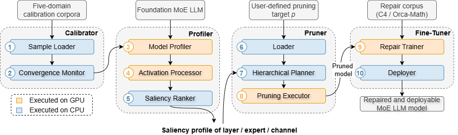

# [Pine: Hierarchical Projection Pruning for Resource-Efficient Mixture-of-Experts LLMs](https://github.com/blessonvar/hpp)
<!-- To be replaced with published link -->
Official PyTorch implementation of **Pine**: Hierarchical Projection Pruning for Resource-Efficient Mixture-of-Experts LLMs

[Abdullah Nazari](https://scholar.google.com/citations?hl=en&user=VJYy_s0AAAAJ) (University of St Andrews, UK), [Bailey J. Eccles](https://scholar.google.com/citations?user=qMdsQCsAAAAJ&hl=en) (EventMAP, UK), [Blesson Varghese](https://scholar.google.com/citations?user=2JoDRIMAAAAJ&hl=en) (University of St Andrews, UK)

<p align="center">

</p>

Pine unifies **inter-projection pruning** (dropping whole experts) and **intra-projection pruning** (slimming the surviving experts channel-by-channel) under a single sparsity budget. One calibrated energy constant `gamma` sets a per-expert channel floor, and two allocation exponents distribute the budget across depth and across experts:

```
total budget -> layer budgets (ALPHA) -> dynamic expert drop (gamma floors) -> survivor widths (BETA) -> channels
```

| Symbol  | Role                                                              |
| ------- | ----------------------------------------------------------------- |
| `gamma` | Per-expert energy-retention threshold -> each expert's channel FLOOR |
| `alpha` | LAYER allocation exponent (depth-aware budget split)               |
| `beta`  | EXPERT allocation exponent (saliency-weighted survivor widths)      |

Existing methods are recovered as special cases of this continuum: a high `gamma` forces every survivor to its full width and reduces Pine to whole-expert pruning (REAP), while a low `gamma` with uniform allocation reduces it to uniform expert slimming.

## Installation

---

Installation instructions can be found in [INSTALL.md](INSTALL.md).

## Usage

---

We provide a quick overview of the arguments. All knobs live in a single `HPPConfig` object (`hpp/config.py`); derived values are exposed as properties so they cannot drift out of sync.

- `model`: The identifier for the MoE model on the Hugging Face model hub.
- `cache_dir`: Directory for loading or storing LLM weights. The default is `llm_weights`.
- `prune_method`: Pruning method, namely [`pine`, `reap`, `slimmoe`, `drop_probe`, `uniform`].
- `sparsity_ratio`: Denotes the percentage of expert parameters to be pruned.
- `gamma`: Per-expert energy-retention threshold that sets each expert's channel floor. Calibrated automatically by `hpp.gamma.calibrate_gamma`.
- `alpha`: Layer allocation exponent controlling the depth-aware split of the global budget.
- `beta`: Expert allocation exponent controlling saliency-weighted survivor widths.
- `nsamples`: Number of packed calibration windows used for the single profiling pass.
- `quantize`: Whether to load the model in quantised precision.
- `save`: Specifies the directory where the results (CSV logs and figures) will be stored.

### Script example of pruning GPT-OSS-20B using Pine

```python
from hpp.models import build
from hpp import runners, gamma as gamma_mod, reconstruction

# 1. Build the config + architecture adapter
cfg, adapter = build("gptoss20b", quantize=False)

# 2. One forward pass -> every statistic, then all saliency scores
scores, prof = runners.setup(cfg, adapter)

# 3. Cliff probe -> calibrated energy constant
cfg.gamma, _ = gamma_mod.calibrate_gamma(cfg, scores)

# 4. Dense reference, then the Pine sparsity sweep
runners.run_baseline(cfg, adapter, "fast_sweep")
runners.run_sweep(cfg, adapter, scores, profile="fast_sweep")

# 5. Optional LoRA repair on C4
reconstruction.run_all_reconstructions(cfg, adapter, scores)
```

### Evaluation protocol

- **Sparsities**: 25 / 50 / 75%. These are exactly reachable by REAP on every evaluated architecture (REAP quantises to `n_prune/E`, floored at `E - top_k`), so every point is a matched comparison. 90% is excluded because Mixtral (`E=8`, top-2) saturates at 75%.
- **Reconstruction**: applied at 75% sparsity, on C4, for 500 steps.
- **Categories**: Math = mean(GSM8K, MATH-500) · MC = 8-suite mean · Code = mean(HumanEval+, MBPP+) (REAP's `Eval+`) · plus WikiText-2 perplexity. Accuracies are reported as fractions in [0, 1].
- **Figures**: always plot `actual_sparsity`, never the requested value.

#### Step 1: profiling and calibration

```
python -m hpp.runners setup --model gptoss20b
```

#### Step 2: obtain pruned models and predictions

```
python -m hpp.runners sweep --model gptoss20b --profile fast_sweep
```

#### Step 3: evaluation results

```
python -m hpp.results report --save save_test/
```

## Repository layout

```
hpp/
  config.py         Every knob. One HPPConfig per (model, precision). Derived values are
                    properties, so they cannot drift.
  adapter.py        The only component that varies per architecture (four methods).
  utils.py          Seed / VRAM / pickle / run_tag helpers.
  calibration.py    Packed REAP-style calibration windows; one builder for all models.
  profiler.py       A single forward pass that collects every required statistic.
  scores.py         layer_imp (ALPHA) | expert_imp (BETA) | reap_imp (baseline) | cscore
  floors.py         Maps gamma to a per-expert channel floor.
  allocator.py      Water-filling stages 1-3 and final channel selection.
  gamma.py          Cliff probe -> answer key -> gamma*
  baselines.py      REAP / SlimMoE / drop-probe expressed as keep-dicts.
  evaluation.py     Perplexity | MC (lm-eval) | Math | Code (EvalPlus CLI) | latency.
  results.py        CSV logging and before/after tables.
  reconstruction.py LoRA repair on C4.
  runners.py        run_baseline / run_hpp / run_reap / run_sweep / setup
  plots/            style.py is the single visual language; one figure per metric.
  models/           One file per architecture: config + adapter.
notebooks/          Thin wrappers: choose knobs, call runners.
```

### Adding a model

Adding an architecture requires one file in `hpp/models/`, containing a `config()` factory and a `ModelAdapter`. If the model stores its experts as a `ModuleList` of MLPs, subclass `UnfusedAdapter` (adding `LogitRouterMixin` if the router returns logits) and only declare `PROJ`, `MOE_ATTR`, and `load`. Fused-tensor architectures require an adapter that slices the expert dimension directly.

### Acknowledgement

This repository is built upon the [REAP](https://github.com/CerebrasResearch/reap), and [Mosaic](https://github.com/blessonvar/Mosaic) repositories. Evaluation uses [lm-evaluation-harness](https://github.com/EleutherAI/lm-evaluation-harness) and [EvalPlus](https://github.com/evalplus/evalplus).

## Citation

If you find this repo helpful, please cite
<!-- To be replaced with actual citation from published version -->
```
@inproceedings{NAZARI2026PINE,
    title     = {Pine: Hierarchical Projection Pruning for Resource-Efficient Mixture-of-Experts LLMs},
    year      = {2026},
    author    = {Abdullah Nazari and Bailey J. Eccles and Blesson Varghese},
}
```